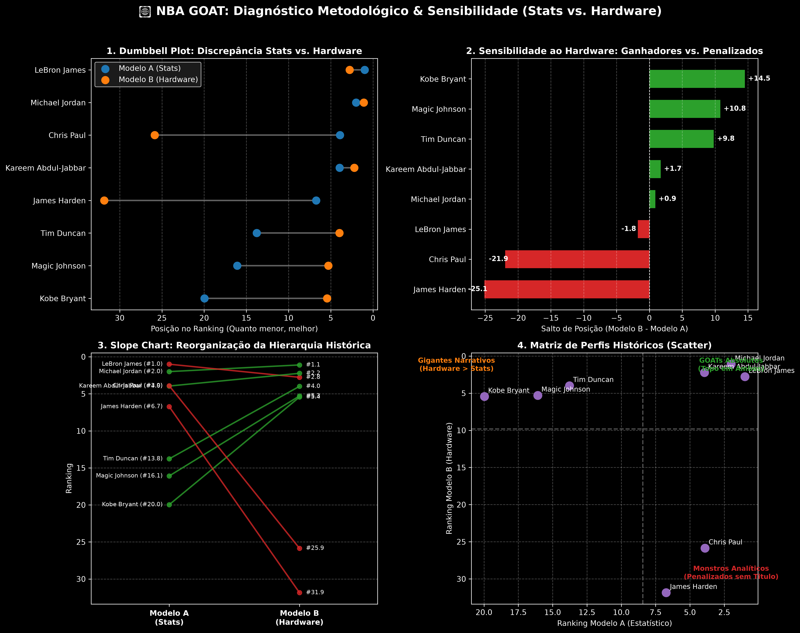

# 🏀 NBA GOAT Dual-Model Sensitivity Analysis (1974–2024)

[](https://www.getdbt.com/)
[](https://duckdb.org/)
[](https://www.python.org/)

## 📌 Visão Geral & Propósito
Este projeto quantifica o impacto do viés narrativo e dos prêmios de mídia no debate sobre quem é o maior jogador de basquete da história da NBA (GOAT).

Através da comparação de dois modelos estatísticos totalmente isolados via simulações de Monte Carlo com Priors de Dirichlet:
- **Modelo A (Pure On-Court / Estatístico):** Avalia estritamente eficiência, pico de 5 anos e volume acumulado (PER, BPM, VORP, WS), isolado de qualquer votação da mídia ou título coletivo.
- **Modelo B (Hardware & Accolades / Narrativo):** Avalia o legado narrativo, domínio em Finais e premiações oficiais (MVPs, FMVPs, All-NBA, All-Defensive).

---

## 🏗️ Arquitetura de Dados & SDLC (Medallion Architecture)

O pipeline utiliza **DuckDB** como Data Warehouse analítico local, transformado e auditado via **dbt**: 

- **Bronze:** Ingestão bruta de estatísticas avançadas históricas por jogador/temporada (`bbr_season_advanced`).
- **Silver:** Normalização dos schemas em `stg_bbr_advanced` e isolamento do pool de candidatos em `int_goat_pool`.
- **Gold:** Tabelas multidimensionais e fatos (`fct_goat_season_zscores`, `gold_pool_candidates` e `gold_player_hardware`).
- **Práticas de SDLC e Qualidade:**
  - **Data Quality:** Suíte de testes automatizados `dbt test` (unicidade por atleta/temporada, plausibilidade estatística de WS e integridade referencial).
  - **Reprodutibilidade:** Transformações SQL versionadas no dbt, isolando a camada de persistência da simulação estocástica em Python.

---

## 🔬 Mitigação de Vieses Metodológicos

1. **Sample Size Bias (Viés do Tamanho da Amostra):**
   - *Desafio:* Jogadores em pico recente (ex: Nikola Jokić) dominam médias por jogo em amostras curtas de carreira.
   - *Solução:* Decomposição vetorial balanceando **Pico das 5 Melhores Temporadas** com **Volume Acumulado**.
2. **Double Counting (Contagem Dupla):**
   - *Desafio:* Pontuar estatísticas avançadas (PER/WS) e prêmios (MVP) no mesmo modelo gera circularidade metodológica.
   - *Solução:* Isolamento 100% estrito entre o Modelo A (Estatístico) e o Modelo B (Hardware).
3. **Disparidade de Eras (1974–2024):**
   - *Desafio:* Métricas e prêmios foram introduzidos em épocas distintas da NBA.
   - *Solução:* Normalização Z-Score intra-temporada calculada exclusivamente ano a ano.

---

## 📊 Principais Descobertas (Modelo A vs. Modelo B)



| Jogador | Rank Modelo A (Stats) | Rank Modelo B (Hardware) | Salto (B - A) | Diagnóstico Metodológico |
| :--- | :---: | :---: | :---: | :--- |
| **Michael Jordan** | #2.00 | **#1.10** | **+0.90** | Dominância absoluta impulsionada por 6x Finals MVP (100% em Finais). |
| **LeBron James** | **#1.00** | #2.77 | **-1.77** | Líder do Modelo A devido à longevidade de elite e volume acumulado de WS/VORP. |
| **Kareem Abdul-Jabbar** | #3.95 | #2.23 | **+1.72** | Estabilizador histórico no Top 4 de ambas as metodologias. |
| **Tim Duncan** | #13.78 | **#3.99** | **+9.80** | Salto expressivo por 5 Anéis, 3 FMVPs e 15 seleções All-Defensive. |
| **Kobe Bryant** | #19.97 | **#5.44** | **+14.56** | **Maior impacto da análise:** Demonstra como o Hardware transforma a percepção de um atleta com estatísticas frias de box score. |
| **Magic Johnson** | #16.09 | **#5.29** | **+10.81** | Ganho expressivo por 3x MVP, 3x FMVP e 5 Títulos. |
| **Chris Paul** | **#3.91** | #25.86 | **-21.95** | Topo em eficiência/posse, severamente penalizado no Hardware por ausência de títulos. |
| **James Harden** | #6.73 | #31.85 | **-25.12** | Altíssima eficiência em temporada regular sem correspondência em títulos. |

---

## 🚀 Como Executar o Projeto Localmente

```bash
# 1. Instalar dependências
pip install -r requirements.txt

# 2. Executar o pipeline dbt (Build & Test)
python -m dbt.cli.main run --project-dir dbt --profiles-dir dbt
python -m dbt.cli.main test --project-dir dbt --profiles-dir dbt

# 3. Executar o confronto dos modelos
python scripts/compare_models.py
