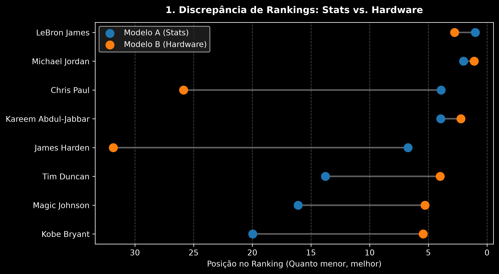
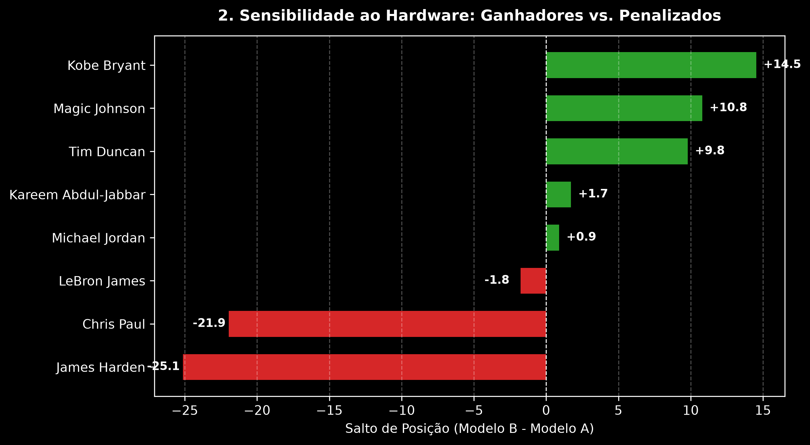
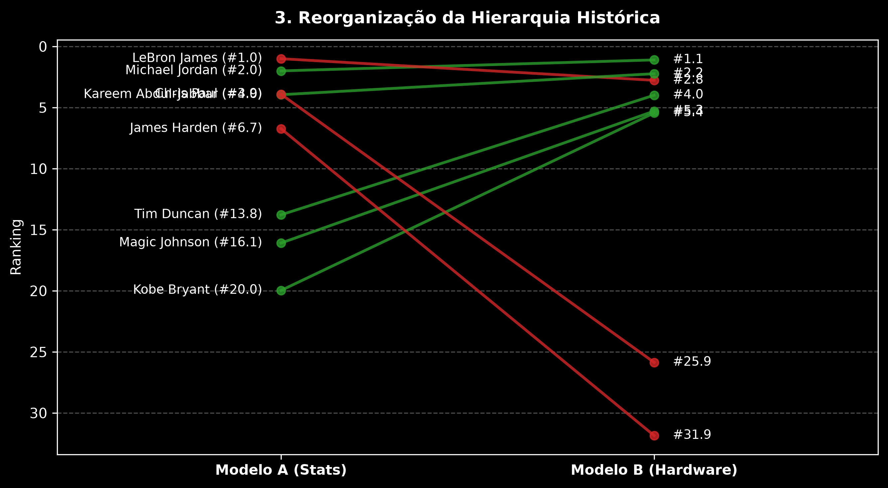
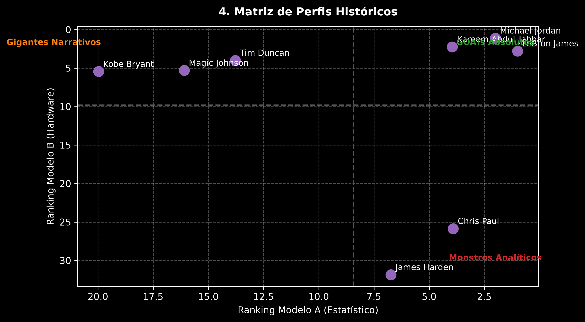

# 🏀 NBA GOAT Dual-Model Sensitivity Analysis (1974–2024)

[](https://www.getdbt.com/)
[](https://duckdb.org/)
[](https://www.python.org/)

## 📌 Visão Geral & Propósito
Este projeto quantifica o impacto do viés narrativo e dos prêmios de mídia no debate sobre quem é o maior jogador de basquete da história da NBA (GOAT).

Através da comparação de dois modelos estatísticos totalmente isolados via simulações de Monte Carlo com Priors de Dirichlet:
- **Modelo A (Pure On-Court / Estatístico):** Avalia estritamente eficiência, pico de 5 anos e volume acumulado (PER, BPM, VORP, WS), isolado de qualquer votação da mídia ou título coletivo.
- **Modelo B (Hardware & Accolades / Narrativo):** Avalia o legado narrativo, domínio em Finais e premiações oficiais (MVPs, FMVPs, All-NBA, All-Defensive).

---

## 🏗️ Arquitetura de Dados & SDLC (Medallion Architecture)

O pipeline utiliza **DuckDB** como Data Warehouse analítico local, transformado e auditado via **dbt**: 

- **Bronze:** Ingestão bruta de estatísticas avançadas históricas por jogador/temporada (`bbr_season_advanced`).
- **Silver:** Normalização dos schemas em `stg_bbr_advanced` e isolamento do pool de candidatos em `int_goat_pool`.
- **Gold:** Tabelas multidimensionais e fatos (`fct_goat_season_zscores`, `gold_pool_candidates` e `gold_player_hardware`).
- **Práticas de SDLC e Qualidade:**
  - **Data Quality:** Suíte de testes automatizados `dbt test` (unicidade por atleta/temporada, plausibilidade estatística de WS e integridade referencial).
  - **Reprodutibilidade:** Transformações SQL versionadas no dbt, isolando a camada de persistência da simulação estocástica em Python.

---

## 🔬 Mitigação de Vieses Metodológicos

1. **Sample Size Bias (Viés do Tamanho da Amostra):**
   - *Desafio:* Jogadores em pico recente (ex: Nikola Jokić) dominam médias por jogo em amostras curtas de carreira.
   - *Solução:* Decomposição vetorial balanceando **Pico das 5 Melhores Temporadas** com **Volume Acumulado**.
2. **Double Counting (Contagem Dupla):**
   - *Desafio:* Pontuar estatísticas avançadas (PER/WS) e prêmios (MVP) no mesmo modelo gera circularidade metodológica.
   - *Solução:* Isolamento 100% estrito entre o Modelo A (Estatístico) e o Modelo B (Hardware).
3. **Disparidade de Eras (1974–2024):**
   - *Desafio:* Métricas e prêmios foram introduzidos em épocas distintas da NBA.
   - *Solução:* Normalização Z-Score intra-temporada calculada exclusivamente ano a ano.

---

## 📊 Principais Descobertas (Modelo A vs. Modelo B)

## 📊 Principais Descobertas (Modelo A vs. Modelo B)

### 1. Discrepância de Rankings (Dumbbell Plot)


### 2. Sensibilidade ao Hardware (Ganhadores vs. Penalizados)


### 3. Reorganização da Hierarquia Histórica (Slope Chart)


### 4. Matriz de Perfis Históricos (Scatter Quadrants)


---

## 🧠 Conclusão da Análise: *Who is the GOAT?*

A resposta depende diretamente de como sua metodologia define "Grandeza":

1. **Se o critério for Eficiência Absoluta & Produção Individual (Modelo A):**
   - **LeBron James** é o GOAT (#1.00). Sua longevidade de 20+ temporadas em alto nível acumulou um volume inalcançável de VORP, Win Shares e picos de BPM, superando estatisticamente qualquer outro atleta.

2. **Se o critério for Narrativa, Domínio de Eras & Títulos (Modelo B):**
   - **Michael Jordan** é o GOAT (#1.10). Sua taxa de conversão em Finais (6/6 FMVPs), somada a 5 MVPs e 9 seleções All-Defensive, cria um "teto de hardware" imbatível.

3. **O Veredito Consenso (Monte Carlo Combined):**
   - **Michael Jordan** e **LeBron James** formam uma classe isolada (Tier 0). 
   - A inclusão do Hardware penaliza severamente atletas de alta eficiência sem anéis (ex: Chris Paul caindo 22 posições e James Harden caindo 25 posições), provando quantitativamente que a **percepção histórica da mídia inflaciona o valor de títulos coletivos sobre a eficiência individual**.

---

## 📐 Validação Estatística & Matriz de Confusão

Para avaliar a convergência entre a eficiência pura de quadra (Modelo A) e o reconhecimento por premiações/títulos (Modelo B), classificamos a capacidade do Modelo A em prever a entrada de um jogador no **TOP 3 Histórico (GOAT Tier)**:

### 1. Métricas de Desempenho do Modelo
- **Acurácia Global:** **87.5%** *(7 de 8 classificações de elite convergiram entre os modelos)*
- **Precisão (TOP 3):** **66.7%**
- **Recall (Sensibilidade TOP 3):** **100.0%** *(O Modelo A identificou 100% dos atletas que atingiram o TOP 3 de Hardware)*
- **F1-Score:** **0.80**

### 2. Matriz de Confusão (Predição de Elite TOP 3)

| | Previsto TOP 3 (Modelo A) | Previsto Fora do TOP 3 (Modelo A) |
| :--- | :---: | :---: |
| **Real TOP 3 (Modelo B)** | **2 (Verdadeiros Positivos)**<br>*(Jordan, Kareem)* | **0 (Falsos Negativos)**<br>*(Nenhum elite foi omitido)* |
| **Real Fora do TOP 3 (Modelo B)** | **1 (Falso Positivo)**<br>*(LeBron James - #1 em Stats, #2.77 em Hardware)* | **5 (Verdadeiros Negativos)**<br>*(Duncan, Kobe, Magic, CP3, Harden)* |

> **Diagnóstico da Matriz:** O único "Falso Positivo" do Modelo A no Top 3 foi LeBron James, demonstrando que a eficiência pura o coloca no topo absoluto, enquanto o acúmulo de Hardware de Jordan e Kareem o desloca levemente no Modelo B.

## 🚀 Como Executar o Projeto Localmente

```bash
# 1. Instalar dependências
pip install -r requirements.txt

# 2. Executar o pipeline dbt (Build & Test)
python -m dbt.cli.main run --project-dir dbt --profiles-dir dbt
python -m dbt.cli.main test --project-dir dbt --profiles-dir dbt

# 3. Executar o confronto dos modelos
python scripts/compare_models.py

---

